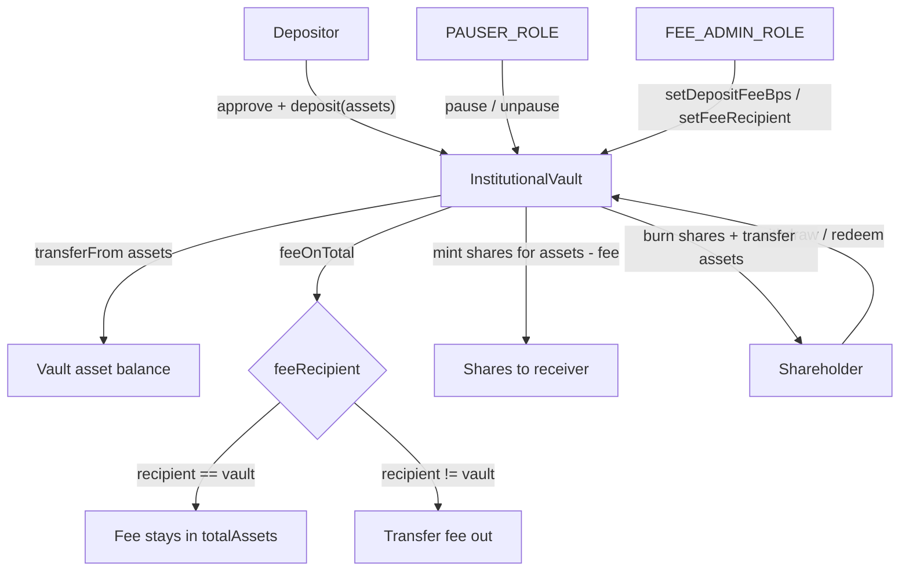

# InstitutionalVault — Architecture

ERC-4626 capped institutional vault for the CapitalSage senior blockchain assessment.

**Stack:** Hardhat 3 · Solidity 0.8.28 · OpenZeppelin Contracts **5.5.0**

**Sources:**

- [ERC-4626](https://ercs.ethereum.org/ERCS/erc-4626)
- [OpenZeppelin ERC-4626 guide](https://docs.openzeppelin.com/contracts/5.x/erc4626) (inflation defense + fee recipe)
- [OpenZeppelin `ERC4626.sol` v5.5.0](https://github.com/OpenZeppelin/openzeppelin-contracts/blob/v5.5.0/contracts/token/ERC20/extensions/ERC4626.sol)
- [OpenZeppelin Proxy docs](https://docs.openzeppelin.com/contracts/5.x/api/proxy)

---

## 1. System & accounting flow

The vault is an **idle** ERC-4626: `totalAssets()` is `balanceOf(vault)` of the underlying (OZ default). There is no external yield strategy; NAV rises when assets are donated or when deposit fees are retained in the vault.



### Deposit fee accounting

- Scale: basis points / `10_000`. Cap: **500 bps (5%)**.
- `previewDeposit(assets)`: `fee = ceil(assets * bps / (bps + 10000))`, then convert `assets - fee` → shares (OZ floor + virtual offset).
- `previewMint(shares)`: convert shares → assets (OZ ceil), then add `ceil(assets * bps / 10000)`.
- `convertToShares` / `convertToAssets`: **fee-free** (EIP-4626 MUST).
- After `super._deposit`, if `fee > 0` and `feeRecipient != address(this)`, fee assets are transferred out. If recipient is the vault, the full pull stays in `totalAssets` while shares were only minted against the net — existing holders gain NAV.

### Share price

OZ conversions (δ = `_decimalsOffset()` = **3**):

```text
shares = assets * (totalSupply + 10**3) / (totalAssets + 1)   // floor on deposit/redeem
assets = shares * (totalAssets + 1) / (totalSupply + 10**3)   // ceil on mint/withdraw
```

Share token decimals = underlying decimals + 3.

---

## 2. Threat modeling & mitigation

### 2.1 First-depositor inflation / donation attack

**Attack:** seed 1 wei of shares → donate a large amount via raw `transfer` (no mint) → victim deposit rounds to 0 shares → attacker redeems inflated claim.

**Delivery paths:**

| Path | Private mempool help? |
|---|---|
| Frontrun victim’s pending first deposit on public mempool | Partially (e.g. Fireblocks `NodeControls.type = MEV`) |
| Attacker first-moves, donates, waits | No |
| Victim deposits into already-poisoned vault | No |

**Mitigation in this vault:** OZ virtual assets (`+1`) and virtual shares (`10**3`). Even with δ=0 the attack is typically unprofitable; δ=3 makes zeroing a realistic deposit orders of magnitude more expensive than it can steal ([OZ analysis](https://docs.openzeppelin.com/contracts/5.x/erc4626)).

**Explicit non-dependency:** private mempools / Fireblocks MEV routing are optional depositor hygiene. They are **not** a substitute for `_decimalsOffset`.

**Residual OZ tradeoffs:** virtual shares capture a tiny fraction of yield; under losses, exit ordering can be asymmetric.

### 2.1.1 Invariants proven in tests (differential method)

Tests use a **test-only** [`contracts/test/NaiveVault.sol`](contracts/test/NaiveVault.sol) that restores pre-v4.9 conversion (no virtual `+1` / `10**δ`) beside `InstitutionalVault` (δ = 3). Same `(seed=1, donation=U, victim=U)` params:

| ID | Statement | Where |
|---|---|---|
| **I1** | Defended vault: victim `previewDeposit(U) > 0` after seed+donation | `InstitutionalVault.inflation.ts` |
| **I2** | Defended: attacker full redeem `< seed + donation` | same |
| **I3** | Clean round-trip recovers ≈U; after classic attack victim claim ≥ U/2 before attacker exits | same |
| **I4** | Naive vault: same params → `previewDeposit(U) == 0`; attacker captures victim assets | same (differential) |
| **I5** | `previewDeposit(A) == A * (supply + 10**3) / (assets + 1)` (floor, fee=0) | same (OZ effective-rate) |
| **I6** | `Σ convertToAssets(balanceOf(h)) ≤ totalAssets()` | inflation + edges |
| **I7** | `convertToShares(A) ≥ previewDeposit(A)`; equality iff fee = 0 | `InstitutionalVault.fees.ts` |

OZ’s own inflation tests note that zeroing a deposit under virtual offset requires frontrun capital on the order of **`10**offset` times the victim amount** ([`ERC4626.test.js`](references/openzeppelin-contracts-v5.5.0/test/token/ERC20/extensions/ERC4626.test.js)). We additionally run a **bound-scale** donation `≈ 10**3 * U` against the defended vault and still assert I1/I2.

Private mempools / Fireblocks MEV routing do **not** replace I1–I2 (see delivery paths above).

### 2.2 Share dilution edge cases

- Direct donations increase `totalAssets` without minting → existing holders benefit; new depositors buy a higher price.
- Retained deposit fees (`feeRecipient == vault`) socialize fees as NAV to existing shareholders.
- External fee recipient removes fee from the pool (treasury capture).

### 2.3 Rounding

OZ / EIP-4626 directions favor the vault:

| Op | Rounding |
|---|---|
| deposit / redeem / convert\* | Floor outputs to user |
| mint / withdraw | Ceil inputs charged to user |

Dust may remain after full redeem; tests assert user out ≤ user in (no yield case).

### 2.4 Access & pause

| Role | Powers |
|---|---|
| `DEFAULT_ADMIN_ROLE` | Grant/revoke roles |
| `PAUSER_ROLE` | `pause` / `unpause` |
| `FEE_ADMIN_ROLE` | `setDepositFeeBps`, `setFeeRecipient` |

While paused: `_deposit` / `_withdraw` revert; `maxDeposit` / `maxMint` / `maxWithdraw` / `maxRedeem` return `0`.

---

## 3. Production readiness & upgradeability

**Shipped code:** non-upgradeable `InstitutionalVault` for assessment clarity and simple storage.

**Institutional recommendation: UUPS** behind `ERC1967Proxy`:

- Upgrade authorization lives in the implementation (`_authorizeUpgrade` + dedicated `UPGRADER_ROLE`), matching OZ’s lightweight preference over Transparent proxies ([Proxy docs](https://docs.openzeppelin.com/contracts/5.x/api/proxy)).
- Lower deploy cost than `TransparentUpgradeableProxy` + `ProxyAdmin`.
- Storage collision prevention: migrate to `openzeppelin-contracts-upgradeable`, namespaced storage / gaps, **append-only** layout; validate with the Upgrades plugin before any upgrade.
- Ops: put `DEFAULT_ADMIN_ROLE` / upgrader behind a multisig; consider `AccessControlDefaultAdminRules` (2-step admin transfer) for production.

**Emergency controls:** `PAUSER_ROLE` on a hot responder key separate from fee admin; document off-chain share-price / min-shares checks for large first deposits (Morpho-style depositor caution) as belt-and-suspenders.

---

## 4. Runbook

**Prerequisite:** Node.js **≥ 22.13.0** (Hardhat 3).

```bash
npm install
npm test
npm run test:gas
```

| Command | Purpose |
|---|---|
| `npm run compile` | Compile contracts |
| `npm test` | Full Mocha suite |
| `npm run test:gas` | Same tests + Hardhat built-in `--gas-stats` |

Pinned library: `@openzeppelin/contracts@5.5.0`.
