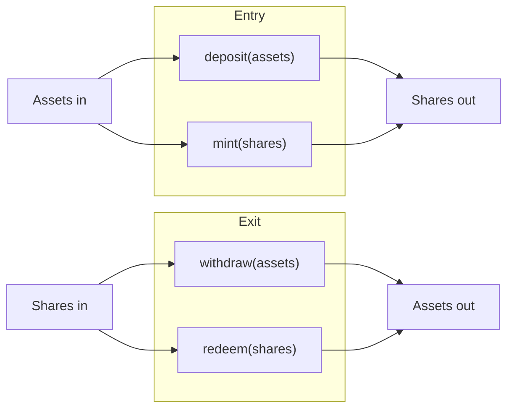
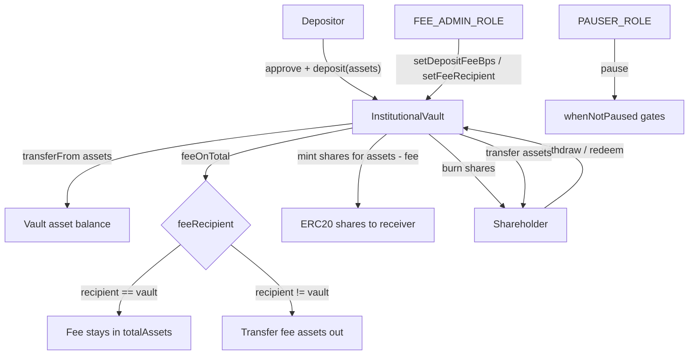

# CapitalSage Assessment — ERC-4626 Explainer + Implementation Plan

This document is the single source of truth for the take-home.

1. **Part A** teaches ERC-4626 from zero (concepts, interface, accounting, fees, attacks, settings), then **§A16** walks real open-source vault code (OZ, sDAI, Morpho, Yearn).
2. **Part B** is the locked, source-backed implementation plan for `InstitutionalVault` on Hardhat 3.

Primary references:

- [ERC-4626: Tokenized Vaults](https://ercs.ethereum.org/ERCS/erc-4626)
- [OpenZeppelin ERC-4626 guide (v5.x)](https://docs.openzeppelin.com/contracts/5.x/erc4626)
- [OpenZeppelin `ERC4626.sol` v5.5.0](https://github.com/OpenZeppelin/openzeppelin-contracts/blob/v5.5.0/contracts/token/ERC20/extensions/ERC4626.sol)
- [Sky `SavingsDai.sol`](https://github.com/sky-ecosystem/sdai/blob/master/src/SavingsDai.sol)
- [Morpho `MetaMorpho.sol`](https://github.com/morpho-org/metamorpho/blob/main/src/MetaMorpho.sol)
- [Yearn `TokenizedStrategy.sol`](https://github.com/yearn/tokenized-strategy/blob/master/src/TokenizedStrategy.sol)
- [Assessment brief](./assessment.md)

---

# Part A — ERC-4626 from zero

## A0. What problem does ERC-4626 solve?

Before ERC-4626, every “vault” (Yearn-style yield vault, lending receipt token, staking wrapper, etc.) invented its own deposit/withdraw API. Integrators had to write a custom adapter per protocol.

**ERC-4626 standardizes one thing:** a vault that:

1. Holds a single underlying **EIP-20 asset** (e.g. USDC, DAI, WETH).
2. Issues its own **EIP-20 share token** representing proportional ownership of those assets.
3. Exposes a fixed set of deposit / mint / withdraw / redeem / preview / convert functions so wallets, aggregators, and routers can integrate once.

Mental model:

```text
User assets  ──deposit/mint──►  Vault holds assets
                                 │
User receives shares ◄───────────┘  (ERC-20 claim on the pool)

Later:
User burns shares ──withdraw/redeem──► User receives assets back
```

The vault share token *is* an ERC-20. `balanceOf(user)` is share balance, not asset balance. Asset value of those shares changes as the vault’s managed assets change.

---

## A1. Core vocabulary

| Term | Meaning |
|---|---|
| **asset** | The underlying ERC-20 the vault manages. Address returned by `asset()`. |
| **shares** | The vault’s own ERC-20. Represent a claim on a fraction of `totalAssets()`. |
| **totalAssets** | How many underlying tokens the vault currently “manages” (for an idle vault: usually its ERC-20 balance). |
| **totalSupply** | How many vault shares exist in total. |
| **exchange rate / share price** | Roughly `totalAssets / totalSupply` (with virtual offsets in OZ — see A7). |
| **fee** | Extra assets/shares taken by the vault on entry, exit, AUM, etc. |
| **slippage** | Difference between an advertised conversion and what the user actually gets, *not* counted as a fee. |
| **preview\*** | “What would this operation do *right now*, including fees?” |
| **convert\*** | “Ideal fee-free conversion at the average share price.” |
| **max\*** | “How much can this receiver/owner do before a hard limit (pause, cap, liquidity)?” |

From the EIP definitions ([ERC-4626](https://ercs.ethereum.org/ERCS/erc-4626)):

- **asset** — underlying token units.
- **share** — vault token with a ratio to assets set by vault accounting.
- **fee** — amount charged by the vault.
- **slippage** — advertised vs economic reality, excluding fees.

---

## A2. The two “sides” of every vault action

Every user interaction is either:

### Entry (assets in → shares out)

| Function | You specify | Vault decides |
|---|---|---|
| `deposit(assets, receiver)` | Exact assets to push in | How many shares to mint |
| `mint(shares, receiver)` | Exact shares you want | How many assets you must pay |

### Exit (shares in → assets out)

| Function | You specify | Vault decides |
|---|---|---|
| `withdraw(assets, receiver, owner)` | Exact assets you want out | How many shares to burn |
| `redeem(shares, receiver, owner)` | Exact shares to burn | How many assets you get |

Why four functions instead of two? UX and integrations:

- “I have 1000 USDC; put it all in” → `deposit`.
- “I want exactly 500 vault shares” → `mint`.
- “I need exactly 100 USDC out” → `withdraw`.
- “Exit my entire share balance” → `redeem`.



---

## A3. Accounting identity (the heart of the protocol)

For a healthy vault with no virtual offsets:

\[
\text{userAssets} \approx \text{userShares} \times \frac{\text{totalAssets}}{\text{totalSupply}}
\]

When you deposit `A` assets into a vault that already has `T` assets and `S` shares, you typically receive:

\[
\text{sharesMinted} = A \times \frac{S}{T}
\]

(with integer rounding — see A6).

**Worked example (no fees, empty-vault special-cased away):**

1. Vault empty conceptually after bootstrap: `totalAssets = 1000`, `totalSupply = 1000` → rate `1.0`.
2. Alice deposits `500` assets → mint `500` shares.
3. Vault earns / receives yield: `totalAssets` becomes `1800`, shares still `1500`.
4. Alice’s `500` shares are now worth \(500 \times 1800 / 1500 = 600\) assets.
5. Bob’s `1000` shares are worth `1200` assets.

Yield (or losses) accrue to shareholders automatically through the exchange rate. No rebase of balances is required: share balances stay fixed; asset value per share moves.

---

## A4. The full interface map (what each function is for)

Grouped the way implementers and integrators think about them.

### A4.1 Identity / metadata

| Function | Role |
|---|---|
| `asset()` | Underlying ERC-20 address. MUST NOT revert. |
| `name` / `symbol` / `decimals` | ERC-20 metadata for **shares** (vault token), not the underlying. |
| `totalAssets()` | Managed underlying amount. SHOULD include yield. MUST include fees charged against vault assets. |

### A4.2 Ideal conversions (fee-free)

| Function | Role | Spec MUST |
|---|---|---|
| `convertToShares(assets)` | Ideal shares for `assets` | NOT include fees; round **down**; caller-independent |
| `convertToAssets(shares)` | Ideal assets for `shares` | NOT include fees; round **down**; caller-independent |

These are for pricing / display / oracles — **not** a guarantee of what `deposit` will mint when fees exist.

### A4.3 Limits

| Function | Role |
|---|---|
| `maxDeposit(receiver)` | Max assets `receiver` can deposit now. `0` if deposits disabled (e.g. paused). `type(uint256).max` if unlimited. |
| `maxMint(receiver)` | Max shares mintable for `receiver`. |
| `maxWithdraw(owner)` | Max assets `owner` can withdraw now (liquidity + balance constrained). |
| `maxRedeem(owner)` | Max shares `owner` can redeem now. |

`max*` MUST NOT revert. A pause circuit breaker often sets entry/exit `max*` to `0`.

### A4.4 Previews (simulate real ops, **including fees**)

| Function | Simulates | Spec MUST |
|---|---|---|
| `previewDeposit(assets)` | `deposit` | Inclusive of deposit fees; ≤ actual shares `deposit` would mint |
| `previewMint(shares)` | `mint` | Inclusive of fees; ≥ actual assets `mint` would pull |
| `previewWithdraw(assets)` | `withdraw` | Inclusive of fees; ≥ actual shares burned |
| `previewRedeem(shares)` | `redeem` | Inclusive of fees; ≤ actual assets returned |

EIP rule of thumb ([ERC-4626](https://ercs.ethereum.org/ERCS/erc-4626)):

> Any unfavorable gap between `convertToShares` and `previewDeposit` SHOULD be treated as slippage/fees — the depositor loses value relative to the ideal rate.

### A4.5 Mutating entry / exit

| Function | Exact input | Returns | Events |
|---|---|---|---|
| `deposit(assets, receiver)` | assets in | shares minted | `Deposit` |
| `mint(shares, receiver)` | shares out | assets in | `Deposit` |
| `withdraw(assets, receiver, owner)` | assets out | shares burned | `Withdraw` |
| `redeem(shares, receiver, owner)` | shares burned | assets out | `Withdraw` |

`owner` on exits allows an approved spender to exit on behalf of a share holder (ERC-20 allowance on **shares**).

Typical UX prerequisite: user `approve`s the vault to pull the **underlying asset** before `deposit` / `mint`.

---

## A5. `deposit` vs `mint`, `withdraw` vs `redeem` (intuition)

Think in “fixed leg” terms:

| You want fixed… | Use | Variable leg |
|---|---|---|
| Assets spent | `deposit` | Shares received (may round down) |
| Shares received | `mint` | Assets spent (may round up) |
| Assets received | `withdraw` | Shares burned (may round up) |
| Shares burned | `redeem` | Assets received (may round down) |

OpenZeppelin encodes that with rounding directions ([`ERC4626.sol`](https://github.com/OpenZeppelin/openzeppelin-contracts/blob/v5.5.0/contracts/token/ERC20/extensions/ERC4626.sol)):

| Preview | Rounding | Favors |
|---|---|---|
| `previewDeposit` | Floor shares | Vault |
| `previewMint` | Ceil assets charged | Vault |
| `previewWithdraw` | Ceil shares burned | Vault |
| `previewRedeem` | Floor assets out | Vault |

**Design principle:** integer dust should favor the vault (existing shareholders), never the incoming/outgoing user in a way that lets them extract extra value.

---

## A6. Rounding, wei dust, and why empty vaults are dangerous

Solidity uses integers. Every `mulDiv` can truncate.

If the exchange rate is extreme (many assets per share), a small deposit can round to **0 shares**. The user still transferred assets → those assets become a donation to existing shareholders.

That property is the root of the **first-depositor / inflation / donation attack** (next section).

---

## A7. The first-depositor inflation (donation) attack

### A7.1 Attack sketch

1. Vault is empty (`totalSupply = 0`, `totalAssets = 0`).
2. Attacker deposits `1` wei of asset → gets `1` share (or similar tiny amount).
3. Attacker **donates** a huge amount of assets with a plain `asset.transfer(vault, huge)` — **not** through `deposit`, so **no new shares** are minted.
4. Exchange rate becomes enormous: e.g. `1` share backs `1e18 + 1` assets.
5. Victim’s pending `deposit(1e18)` computes shares ≈ `1e18 * 1 / (1e18+1)` → **rounds to 0**.
6. Victim gets nothing; attacker redeems the only share and steals the victim’s deposit (+ keeps most of the donation mechanics depending on math).

**Delivery paths (important):**

| Path | Needs public mempool visibility? | Still possible? |
|---|---|---|
| Same-block / next-block **frontrun** of a victim’s pending first deposit | Yes — classic public-mempool MEV | Reduced if the victim’s tx never enters the public mempool |
| Attacker is simply **first depositor**, donates, then waits for any later deposit | No | Yes |
| Vault already poisoned in a **prior block**; victim deposits later (even privately) | No | Yes — victim hits bad exchange rate regardless of how their tx is relayed |

“Front-running a victim’s first deposit makes this practical on public mempools” describes path 1 only. It is **not** the whole threat.

#### Private mempools / Fireblocks / MEV-protected routing — what the plan does with them

**The plan does not rely on private mempools as inflation defense.** That is intentional.

Institutional wallets (e.g. Fireblocks) can route transactions with MEV-oriented controls — Fireblocks documents `NodeControls.type = "MEV"` to send txs to a configured MEV-protection provider rather than a naive public broadcast ([Fireblocks transaction objects / NodeControls](https://fireblocks.readme.io/reference/transaction-objects)). Broader “pre-execution privacy” efforts (e.g. encrypted orderflow / Fairblock-style designs Fireblocks has discussed publicly) also aim to hide intent until inclusion.

What that **does** buy for vault users:

- Harder for searchers to see and **frontrun** a specific pending `deposit` in the public mempool.
- Useful operational hygiene for sizeable institutional flow (sandwiches, copy-trading, deposit frontrun).

What that **does not** buy:

- It does **not** reset a vault whose share price was already inflated by a prior deposit+donation.
- It does **not** stop an attacker who never needed to see the victim — empty vault + first mover is enough.
- It is **not** enforceable inside `InstitutionalVault.sol`; users who deposit via a public RPC remain exposed on path 1.
- Assessment graders expect **contract-level** mitigation (virtual offset or dead shares), not “assume Fireblocks.”

**Plan stance (locked):**

1. **Primary control:** OZ virtual shares/assets with `_decimalsOffset() = 3` — works for all delivery paths above.
2. **Secondary (tests / ops narrative):** optional seed deposit and off-chain min-shares / share-price checks (Morpho-style depositor caution) belong in `ARCHITECTURE.md` runbook language, not as substitutes for offset.
3. **Private mempool / Fireblocks MEV routing:** document in threat model as **complementary user-side MEV hygiene** for institutional depositors — explicitly **out of scope** as a vault security dependency. Do not add Fireblocks SDK, private-relay adapters, or “only works with private mempool” assumptions to the Solidity or Hardhat tests.

Source walkthrough: [OZ ERC-4626 — Inflation attack](https://docs.openzeppelin.com/contracts/5.x/erc4626).

### A7.2 Defenses you will see in the wild

| Defense | Idea |
|---|---|
| **Dead shares / initial burn** | Mint and lock/burn a non-trivial seed so the vault is never “economically empty.” |
| **Virtual shares + virtual assets (OZ)** | Pretend the vault always has `1` virtual asset and `10**offset` virtual shares in conversion math. |
| **Deposit routers with slippage checks** | User reverts if shares received < min (doesn’t fix empty vault alone, but protects users). |
| **Minimum deposit / shares out** | Reject ops that would mint 0 shares. |

### A7.3 OpenZeppelin virtual offset (what we use)

Since OZ v4.9 / v5, conversions are:

```solidity
// Conceptual — from OZ ERC4626
shares = assets.mulDiv(totalSupply() + 10**decimalsOffset, totalAssets() + 1, rounding);
assets = shares.mulDiv(totalAssets() + 1, totalSupply() + 10**decimalsOffset, rounding);
```

- Even with `offset = 0`, virtual `+1` asset / `+1` share makes pure profitable theft much harder.
- With `offset = 3`, attacking a user costs orders of magnitude more than can be stolen (OZ analysis).

**Tradeoffs (honest, from OZ docs):**

- Virtual shares capture a tiny fraction of yield.
- On losses, exit ordering can be asymmetric (early exiters hurt less than last exiters).
- Share `decimals()` become `underlyingDecimals + offset` in OZ.

Our plan locks **`_decimalsOffset() = 3`**.

---

## A8. Fees in ERC-4626 (critical compliance rules)

Fees are allowed, but the EIP is strict about *where* they appear.

### A8.1 Spec rules

| API | Fees? |
|---|---|
| `convertToShares` / `convertToAssets` | MUST **NOT** include fees |
| `previewDeposit` / `previewMint` / `previewWithdraw` / `previewRedeem` | MUST include the relevant fees |
| `deposit(assets, …)` | Caller supplies **exactly** `assets` (fees come out of that amount for entry fees) |
| `Deposit` event (OZ guidance) | Asset amount should reflect what the user paid, **including** fees |

See [OZ — Adding fees to the vault](https://docs.openzeppelin.com/contracts/5.x/erc4626).

### A8.2 Entry fee economics (deposit fee)

If fee = 1% (100 bps) and user `deposit`s `1000` assets:

- Vault pulls `1000` assets from user.
- Fee portion ≈ `10` assets goes to `feeRecipient` (or stays in vault).
- Shares are minted as if only ≈ `990` assets were contributed to the shareholder pool.

Two recipient modes:

| `feeRecipient` | Effect |
|---|---|
| External treasury | Fee leaves vault; treasury balance up; shareholders do not get that fee as yield. |
| `address(vault)` itself | Fee stays in `totalAssets` but did not mint proportional shares → existing shareholders gain NAV. |

### A8.3 Basis points (bps)

| bps | Percent |
|---|---|
| 1 | 0.01% |
| 100 | 1% |
| 500 | 5% (assessment maximum) |
| 10_000 | 100% |

OZ fee helpers (same math we will use):

- **`feeOnRaw(assets, bps)`** — fee to *add on top* of a raw amount (used for `mint` / `withdraw` style quotes). Rounds **up**.
- **`feeOnTotal(assets, bps)`** — fee portion *inside* an amount that already includes fee (used for `deposit` / `redeem` style quotes). Rounds **up**.

Formulas:

\[
\text{feeOnRaw} = \left\lceil \text{assets} \times \frac{\text{bps}}{10000} \right\rceil
\]

\[
\text{feeOnTotal} = \left\lceil \text{assets} \times \frac{\text{bps}}{\text{bps} + 10000} \right\rceil
\]

### A8.4 What our assessment requires

- Configurable **deposit** fee only.
- Admin-controlled.
- Cap **500 bps**.
- Fees may remain in vault **or** route to a recipient (we support both via `feeRecipient`).

---

## A9. Protocol variables & settings cheat sheet

This is the “operator console” view of a vault — what exists in the EIP vs what we add for CapitalSage.

### A9.1 EIP-4626 / OZ base state (always present)

| Variable / view | Set how? | Meaning |
|---|---|---|
| `asset` | constructor (immutable in OZ) | Underlying ERC-20 |
| share `name` / `symbol` | constructor | Vault token metadata |
| share `decimals` | derived | In OZ: `asset.decimals + _decimalsOffset()` |
| `totalSupply` | mint/burn shares | Outstanding shares |
| balances / allowances | ERC-20 | Share ownership & spend approval |
| `totalAssets()` | accounting function | Managed assets (OZ default: `balanceOf(vault)`) |

### A9.2 OZ inflation knobs

| Setting | Our value | Effect |
|---|---|---|
| `_decimalsOffset()` | `3` | Virtual shares = `10**3 = 1000`; harder inflation attack; share decimals += 3 |

### A9.3 CapitalSage institutional settings (our contract)

| Setting | Type | Who changes | Bounds / notes |
|---|---|---|---|
| `depositFeeBps` | `uint16` | `FEE_ADMIN_ROLE` | `0 … 500` |
| `feeRecipient` | `address` | `FEE_ADMIN_ROLE` | nonzero; may be vault itself |
| paused flag | `Pausable` | `PAUSER_ROLE` | when paused: entry/exit blocked; `max*` → 0 |
| `DEFAULT_ADMIN_ROLE` | role | admin | grants/revokes other roles |
| `PAUSER_ROLE` | role | admin-granted | `pause` / `unpause` |
| `FEE_ADMIN_ROLE` | role | admin-granted | fee + recipient updates |

### A9.4 Constants

| Constant | Value | Why |
|---|---|---|
| `MAX_DEPOSIT_FEE_BPS` | `500` | Assessment hard cap (5%) |
| `BPS_DENOMINATOR` | `10_000` | Standard bps scale (`1e4`) |

### A9.5 What we deliberately do **not** configure in v1

| Setting | Status |
|---|---|
| Exit / withdrawal fee | Not in assessment scope |
| Performance fee / AUM fee | Out of scope |
| External yield strategy / allocator | Idle vault only |
| Deposit cap / whitelist | Not required (could return finite `maxDeposit` later) |
| On-chain upgradeability | Documented as UUPS for production; shipped code is non-proxy |

---

## A10. Lifecycle of one deposit (step-by-step)

Assume `depositFeeBps = 100` (1%), `feeRecipient = treasury`, offset = 3, vault already has liquidity.

1. User approves vault for ≥ `assets` of underlying.
2. User calls `deposit(assets, receiver)`.
3. Vault checks `assets <= maxDeposit(receiver)` (fails if paused / capped).
4. `shares = previewDeposit(assets)`:
   - `fee = feeOnTotal(assets, 100)`
   - convert `assets - fee` → shares (OZ virtual-offset math, floor).
5. `_deposit`:
   - `transferFrom(user, vault, assets)`
   - mint `shares` to `receiver`
   - if fee > 0 and recipient ≠ vault: `transfer(treasury, fee)`
6. Emit `Deposit(user, receiver, assets, shares)`.
7. User (or UI) should have compared `shares` to an off-chain min-out; ERC-4626 itself has no slippage parameter on `deposit`.

---

## A11. Access control & circuit breakers (institutional extras)

ERC-4626 does **not** define admin roles. Production vaults add them.

| Concern | Mechanism | ERC-4626 touchpoint |
|---|---|---|
| Emergency stop | `Pausable` | `whenNotPaused` on `_deposit`/`_withdraw`; `max* = 0` while paused |
| Who can pause | `PAUSER_ROLE` | — |
| Who can change fees | `FEE_ADMIN_ROLE` | changes preview results immediately |
| Who manages roles | `DEFAULT_ADMIN_ROLE` | should be multisig in production |

OZ docs recommend hardening the default admin with [`AccessControlDefaultAdminRules`](https://docs.openzeppelin.com/contracts/5.x/access-control) (2-step transfer) for real deployments — note that in architecture write-up even if we keep simpler `AccessControl` in the assessment contract for clarity.

---

## A12. Upgradeability (conceptual precursor)

Proxies let you change vault *logic* while keeping the same address / storage / share balances.

| Pattern | Where upgrade code lives | OZ stance |
|---|---|---|
| **Transparent Proxy** | Proxy + `ProxyAdmin` | Heavier deploy; admin cannot call impl functions through proxy |
| **UUPS** | Implementation (`UUPSUpgradeable`) behind `ERC1967Proxy` | OZ’s preferred lightweight direction |

Storage collision risk: new implementation must **append** storage, never reorder. Upgradeable OZ contracts use namespaced storage / gaps.

**Our assessment delivery:** non-upgradeable implementation for clarity + tests; `ARCHITECTURE.md` recommends UUPS for institutional production.

---

## A13. How to read vault state as an operator

Useful checklist when debugging or writing tests:

1. `asset()` — correct underlying?
2. `totalAssets()` vs `asset.balanceOf(vault)` — equal for idle OZ vault; diverge if strategies exist.
3. `totalSupply()` — zero means “economically fragile” without virtual offset / seed.
4. `convertToAssets(1e18)` — share price intuition (watch decimals!).
5. `previewDeposit(1e18)` vs `convertToShares(1e18)` — gap ≈ fees/slippage.
6. `depositFeeBps`, `feeRecipient` — fee policy.
7. `paused()` — circuit breaker.
8. `hasRole(PAUSER_ROLE, x)` / fee admin — who can change risk surface.

---

## A14. Glossary of pitfalls (read before coding)

1. **Do not put fees inside `convertTo*`** — breaks EIP and integrators.
2. **Do not forget fees inside `preview*`** — also breaks EIP.
3. **Donations via `transfer` change `totalAssets` without minting shares** — feature and attack surface.
4. **0-share mints** — always consider rounding; revert or defend with offset.
5. **Share decimals ≠ asset decimals** once offset > 0.
6. **`maxDeposit` ignoring pause** — integrators will think deposits work until the tx reverts.
7. **Fee recipient = vault** silently socializes fees as yield — document it.
8. **Testing only `deposit`/`redeem`** — still write `mint`/`withdraw`; rounding paths differ.

---

## A15. Minimal numeric lab (do this on paper)

Assume no fees, offset `0` virtual still `+1` / `+1` as in OZ, empty vault:

1. First depositor deposits `1000` assets.
2. Compute shares with OZ formula:
   - `shares = 1000 * (0 + 10**0) / (0 + 1) = 1000`.
3. Attacker instead tries: deposit `1`, donate `10_000`.
4. Victim deposits `1000` — compute victim shares; observe they are not zero with virtual assets, and attacker cannot extract profit cleanly.
5. Repeat mental math with `offset = 3` (`10**3 = 1000` virtual shares) and notice victim share count scales up → donation needed to zero them becomes huge.

Keep this lab in mind when writing `InstitutionalVault.inflation.ts`.

---

## A16. Learning from real open-source vaults

This section is a guided reading tour of production / widely used ERC-4626 code.

**The repos are cloned into this workspace** under [`references/`](./references/) (see [`references/README.md`](./references/README.md)). Open those local files in the IDE while reading the annotations. Upstream GitHub links are included for provenance only.

The goal is pattern recognition, not copy-paste — our assessment vault is intentionally simpler (idle assets, deposit fee, pause, virtual offset).

### A16.1 Map of references (local paths)

| Protocol / library | Local path | Upstream | What to learn |
|---|---|---|---|
| **OpenZeppelin ERC4626** | [`references/openzeppelin-contracts-v5.5.0/contracts/token/ERC20/extensions/ERC4626.sol`](./references/openzeppelin-contracts-v5.5.0/contracts/token/ERC20/extensions/ERC4626.sol) | [GitHub v5.5.0](https://github.com/OpenZeppelin/openzeppelin-contracts/blob/v5.5.0/contracts/token/ERC20/extensions/ERC4626.sol) | Canonical idle vault: convert/preview rounding, `_deposit`/`_withdraw` ordering, virtual offset |
| **OpenZeppelin fee recipe** | (docs example; not a separate file in the clone) | [Docs: Adding fees](https://docs.openzeppelin.com/contracts/5.x/erc4626) | EIP-compliant entry/exit fee wiring on `preview*` + `_deposit` |
| **Sky/Maker sDAI** | [`references/sky-sdai/src/SavingsDai.sol`](./references/sky-sdai/src/SavingsDai.sol) | [GitHub](https://github.com/sky-ecosystem/sdai/blob/master/src/SavingsDai.sol) | Minimal hand-rolled 4626; yield via external rate (`pot.chi`); ceil on mint/withdraw |
| **Morpho MetaMorpho** | [`references/morpho-metamorpho/src/MetaMorpho.sol`](./references/morpho-metamorpho/src/MetaMorpho.sol) | [GitHub](https://github.com/morpho-org/metamorpho/blob/main/src/MetaMorpho.sol) | OZ inheritance + custom `totalAssets`, decimals offset, **performance fee as share mint**, role/timelock ops |
| **Yearn V3 TokenizedStrategy** | [`references/yearn-tokenized-strategy/src/TokenizedStrategy.sol`](./references/yearn-tokenized-strategy/src/TokenizedStrategy.sol) | [GitHub](https://github.com/yearn/tokenized-strategy/blob/master/src/TokenizedStrategy.sol) | Pause on 4626 entry/exit, `ZERO_SHARES` guard, profit unlock, bps fees on report |

Suggested reading order: **OZ → sDAI → Morpho deposit/fee → Yearn pause/deposit → OZ fee docs**.

---

### A16.2 OpenZeppelin — the base machine you will extend

Local: [`references/openzeppelin-contracts-v5.5.0/contracts/token/ERC20/extensions/ERC4626.sol`](./references/openzeppelin-contracts-v5.5.0/contracts/token/ERC20/extensions/ERC4626.sol)  
Upstream: [v5.5.0 on GitHub](https://github.com/OpenZeppelin/openzeppelin-contracts/blob/v5.5.0/contracts/token/ERC20/extensions/ERC4626.sol).

**Idle `totalAssets` = vault token balance**

```solidity
function totalAssets() public view virtual returns (uint256) {
    return IERC20(asset()).balanceOf(address(this));
}
```

Our assessment vault keeps this default. Morpho overrides it (A16.4) because assets sit in Morpho markets, not on the vault.

**Public ops always go through `preview*` then `_deposit` / `_withdraw`**

```solidity
function deposit(uint256 assets, address receiver) public virtual returns (uint256) {
    uint256 maxAssets = maxDeposit(receiver);
    if (assets > maxAssets) {
        revert ERC4626ExceededMaxDeposit(receiver, assets, maxAssets);
    }

    uint256 shares = previewDeposit(assets);
    _deposit(_msgSender(), receiver, assets, shares);

    return shares;
}
```

Teaching point: if you change fee math, change **`previewDeposit`**, not a one-off calculation inside `deposit`, or preview and execution drift (EIP violation + integrator bugs).

**Virtual inflation defense (the math we keep)**

```solidity
function _convertToShares(uint256 assets, Math.Rounding rounding) internal view virtual returns (uint256) {
    return assets.mulDiv(totalSupply() + 10 ** _decimalsOffset(), totalAssets() + 1, rounding);
}

function _decimalsOffset() internal view virtual returns (uint8) {
    return 0; // we override to 3
}
```

**Reentrancy-aware transfer ordering** (read the NatSpec in-file):

- `_deposit`: **transfer assets first, then mint shares**
- `_withdraw`: **burn shares first, then transfer assets**

That ordering is deliberate for ERC-777 hooks; keep it when overriding `_deposit` for fees.

**OZ override guidance (from the same file’s NOTE):** prefer overriding **`_deposit` / `_withdraw`** (and matching `preview*`), not the four public functions, so `deposit`/`mint` and `withdraw`/`redeem` cannot diverge.

---

### A16.3 Sky sDAI — smallest “real yield” 4626

Local: [`references/sky-sdai/src/SavingsDai.sol`](./references/sky-sdai/src/SavingsDai.sol)  
Upstream: [sky-ecosystem/sdai](https://github.com/sky-ecosystem/sdai/blob/master/src/SavingsDai.sol) · docs: [Spark sDAI](https://docs.spark.finance/dev/savings/sdai-token).

sDAI does **not** inherit OZ ERC4626. It implements the interface by hand and prices shares with Maker’s DSR index `chi` (RAY = 1e27).

**Asset identity + totalAssets from share supply**

```solidity
function asset() external view returns (address) {
    return address(dai);
}

function totalAssets() external view returns (uint256) {
    return convertToAssets(totalSupply);
}
```

Unlike OZ idle vaults, `totalAssets` is **not** `dai.balanceOf(this)` — it is “what the outstanding shares are worth under current `chi`.” Yield accrues by `chi` rising over time, even between txs (views use `_rpow` if `pot` wasn’t dripped).

**convert vs previewMint rounding (same EIP idea as OZ)**

```solidity
function convertToShares(uint256 assets) public view returns (uint256) {
    // ... resolve chi ...
    return assets * RAY / chi;          // floor
}

function previewMint(uint256 shares) external view returns (uint256) {
    // ... resolve chi ...
    return _divup(shares * chi, RAY);   // ceil assets charged
}

function deposit(uint256 assets, address receiver) public returns (uint256 shares) {
    uint256 chi = (block.timestamp > pot.rho()) ? pot.drip() : pot.chi();
    shares = assets * RAY / chi;        // floor shares
    _mint(assets, shares, receiver);
}
```

Learning takeaways for our vault:

1. **Floor when giving shares / assets out; ceil when charging shares / assets in.**
2. `previewDeposit == convertToShares` here because sDAI has **no deposit fee** — the moment we add fees, those two **must diverge** (EIP).
3. Mutating paths call `pot.drip()` so state matches accrued yield before mint/burn — analogous to Morpho calling `_accrueFee()` before every 4626 op.

---

### A16.4 Morpho MetaMorpho — institutional patterns on top of OZ

Local: [`references/morpho-metamorpho/src/MetaMorpho.sol`](./references/morpho-metamorpho/src/MetaMorpho.sol)  
Upstream: [morpho-org/metamorpho](https://github.com/morpho-org/metamorpho/blob/main/src/MetaMorpho.sol).

MetaMorpho **inherits OZ `ERC4626`**, then specializes accounting, fees, and roles. This is the closest “grown-up” cousin to our design.

**Decimals offset chosen from underlying decimals**

```solidity
DECIMALS_OFFSET = uint8(uint256(18).zeroFloorSub(IERC20Metadata(_asset).decimals()));

function _decimalsOffset() internal view override returns (uint8) {
    return DECIMALS_OFFSET;
}
```

For an 18-decimal asset, offset becomes `0`. Morpho documents the residual inflation risk explicitly on `deposit`:

```solidity
/// @notice For tokens with 18 decimals, the protection against the inflation front-running attack is low. To
/// protect against this attack, vault deployers should make an initial deposit of a non-trivial amount in the vault
/// or depositors should check that the share price does not exceed a certain limit.
function deposit(uint256 assets, address receiver) public override returns (uint256 shares) {
    uint256 newTotalAssets = _accrueFee();
    lastTotalAssets = newTotalAssets;
    shares = _convertToSharesWithTotals(assets, totalSupply(), newTotalAssets, Math.Rounding.Floor);
    _deposit(_msgSender(), receiver, assets, shares);
}
```

**Contrast with our plan:** we force `_decimalsOffset() = 3` even for 18-decimal assets so the assessment’s inflation test is robust without relying on a seed deposit. Morpho’s comment is exactly why that choice exists.

**Custom `totalAssets` (allocated liquidity, not idle balance)**

```solidity
function totalAssets() public view override returns (uint256 assets) {
    for (uint256 i; i < withdrawQueue.length; ++i) {
        assets += MORPHO.expectedSupplyAssets(_marketParams(withdrawQueue[i]), address(this));
    }
}
```

We will **not** do this — no strategy. But understand: whatever `totalAssets` returns **is** the denominator of share price. Wrong `totalAssets` ⇒ insolvent vault.

**Performance fee ≠ deposit fee (study the difference)**

Morpho takes a **cut of interest**, paid by **minting shares to `feeRecipient`** (dilution), not by skimming deposit principal:

```solidity
function setFee(uint256 newFee) external onlyOwner {
    if (newFee > ConstantsLib.MAX_FEE) revert ErrorsLib.MaxFeeExceeded();
    if (newFee != 0 && feeRecipient == address(0)) revert ErrorsLib.ZeroFeeRecipient();
    _updateLastTotalAssets(_accrueFee()); // settle under old rate first
    fee = uint96(newFee);
}

function _accrueFee() internal returns (uint256 newTotalAssets) {
    uint256 feeShares;
    (feeShares, newTotalAssets) = _accruedFeeShares();
    if (feeShares != 0) _mint(feeRecipient, feeShares);
}

function _accruedFeeShares() internal view returns (uint256 feeShares, uint256 newTotalAssets) {
    newTotalAssets = totalAssets();
    uint256 totalInterest = newTotalAssets.zeroFloorSub(lastTotalAssets);
    if (totalInterest != 0 && fee != 0) {
        uint256 feeAssets = totalInterest.mulDiv(fee, WAD);
        feeShares = _convertToSharesWithTotals(
            feeAssets, totalSupply(), newTotalAssets - feeAssets, Math.Rounding.Floor
        );
    }
}
```

| | Morpho performance fee | Our assessment deposit fee |
|---|---|---|
| When charged | On interest since `lastTotalAssets` | On each `deposit`/`mint` |
| How paid | Mint vault shares to recipient | Take assets (transfer out or retain) |
| Unit | WAD (1e18 = 100%), cap 50% | bps / 10_000, cap 500 bps |
| EIP surface | Accrue before convert so rate is fair | Override `previewDeposit`/`previewMint` + `_deposit` |

**Do not mix these models in code.** Our OZ fee recipe (asset skim on entry) is the correct match for the brief.

**Operator settings worth noting in MetaMorpho**

- `fee`, `feeRecipient`, `lastTotalAssets`
- `curator`, `isAllocator`, `guardian`, `timelock` / pending guardianship
- `supplyQueue` / `withdrawQueue` (allocation policy)

Our thinner institutional surface: `depositFeeBps`, `feeRecipient`, `PAUSER_ROLE`, `FEE_ADMIN_ROLE`, `DEFAULT_ADMIN_ROLE`.

---

### A16.5 Yearn V3 TokenizedStrategy — pause, zero-share guard, bps

Local: [`references/yearn-tokenized-strategy/src/TokenizedStrategy.sol`](./references/yearn-tokenized-strategy/src/TokenizedStrategy.sol), [`references/yearn-tokenized-strategy/SPECIFICATION.md`](./references/yearn-tokenized-strategy/SPECIFICATION.md)  
Upstream: [yearn/tokenized-strategy](https://github.com/yearn/tokenized-strategy).

Yearn uses a shared implementation via `delegatecall` (strategies stay tiny). Conceptually it is still a 4626 vault with management/emergency roles.

**Pause gates user 4626 functions**

```solidity
function deposit(
    uint256 assets,
    address receiver
) external whenNotPaused nonReentrant returns (uint256 shares) {
    StrategyData storage S = _strategyStorage();
    _accrue(S);
    // ...
    require(assets <= _maxDeposit(S, receiver), "ERC4626: deposit more than max");
    require(
        (shares = _convertToShares(S, assets, Math.Rounding.Down)) != 0,
        "ZERO_SHARES"
    );
    _deposit(S, receiver, assets, shares);
}

function setPaused(bool paused) external {
    if (paused) {
        requireEmergencyAuthorized(msg.sender); // management OR emergencyAdmin
    } else {
        requireManagement(msg.sender);          // only management unpauses
    }
    _strategyStorage().paused = paused;
    emit UpdatePaused(paused);
}
```

Learning for our circuit breaker:

1. Pause **user** entry/exit; keep admin paths alive (Yearn still allows tend/report/shutdown tooling while paused — read NatSpec on `setPaused`).
2. Asymmetric pause/unpause authority is a real ops pattern (emergency can halt; only management resumes).
3. Explicit **`ZERO_SHARES`** revert is a second line of defense beside virtual offsets — worth mirroring in tests even if OZ `deposit` would mint 0 only in pathological cases.

**Conversion without OZ virtual offset (empty vault = 1:1)**

```solidity
function _convertToSharesFromTotals(
    uint256 assets,
    uint256 supply,
    uint256 totalAssets_,
    Math.Rounding _rounding
) internal pure returns (uint256) {
    if (supply == 0) return assets;
    if (totalAssets_ == 0) return 0;
    return assets.mulDiv(supply, totalAssets_, _rounding);
}
```

Yearn historically relied more on **non-empty bootstrapping / reporting** and loss parameters than OZ virtual shares. That is why empty-vault donation attacks are a recurring 4626 lesson — different codebases pick different mitigations. **We stick to OZ virtual offset** because we inherit OZ ERC4626.

**Fees on profit report use `MAX_BPS = 10_000`** — same bps scale we will use for `depositFeeBps`, even though Yearn’s fee is charged at `report()` on profit, not on deposit.

---

### A16.6 OpenZeppelin fee example — the pattern we will implement

From the official guide [ERC-4626 — Adding fees](https://docs.openzeppelin.com/contracts/5.x/erc4626) (example contract `ERC4626Fees`):

```solidity
function previewDeposit(uint256 assets) public view virtual override returns (uint256) {
    uint256 fee = _feeOnTotal(assets, _entryFeeBasisPoints());
    return super.previewDeposit(assets - fee);
}

function previewMint(uint256 shares) public view virtual override returns (uint256) {
    uint256 assets = super.previewMint(shares);
    return assets + _feeOnRaw(assets, _entryFeeBasisPoints());
}

function _deposit(address caller, address receiver, uint256 assets, uint256 shares) internal virtual override {
    uint256 fee = _feeOnTotal(assets, _entryFeeBasisPoints());
    address recipient = _entryFeeRecipient();

    super._deposit(caller, receiver, assets, shares);

    if (fee > 0 && recipient != address(this)) {
        SafeERC20.safeTransfer(IERC20(asset()), recipient, fee);
    }
}
```

Map onto CapitalSage:

| OZ example hook | Our concrete setting |
|---|---|
| `_entryFeeBasisPoints()` | `depositFeeBps` (storage, ≤ 500) |
| `_entryFeeRecipient()` | `feeRecipient` |
| `_exitFeeBasisPoints()` | always `0` (out of scope) |
| `recipient == address(this)` | skip transfer → fee stays in vault NAV |

---

### A16.7 Side-by-side: what we adopt vs leave alone

| Pattern | OZ | sDAI | Morpho | Yearn | Our vault |
|---|---|---|---|---|---|
| Inherit OZ ERC4626 | yes | no (hand-rolled) | yes | custom impl | **yes** |
| Idle `balanceOf` totalAssets | yes | no (chi) | no (Morpho markets) | strategy assets | **yes (idle)** |
| Virtual decimals offset | yes (`_decimalsOffset`) | n/a | yes (`18 - decimals`) | no (1:1 empty) | **yes, fixed 3** |
| Deposit / entry fee | example only | no | no | no | **yes (bps)** |
| Performance fee | no | no | yes (share mint) | yes (on report) | **no** |
| Pause entry/exit | via Pausable addon | no | no (other controls) | yes | **yes** |
| Role separation | AccessControl addon | none | owner/curator/allocator/guardian | management/emergencyAdmin | **admin/pauser/feeAdmin** |
| `ZERO_SHARES` guard | soft (0 mint possible) | floor math | floor math | explicit revert | **rely on offset + tests; optional require** |

---

### A16.8 Study checklist (do this before writing Solidity)

Open each file under `references/` in the IDE and answer in writing (even bullet notes in this repo later if you want):

1. **OZ `deposit` → `_deposit`:** Where would you insert a deposit fee so `previewDeposit` stays truthful?
2. **sDAI `previewMint` vs `convertToAssets`:** Why does mint use `_divup`?
3. **Morpho `deposit` NatSpec:** Why is offset `0` dangerous for 18-decimal assets? How does our offset `3` change that?
4. **Morpho `_accrueFee`:** Is that a deposit fee? If you copied it into an assessment “deposit fee,” what would a reviewer say?
5. **Yearn `setPaused`:** Who can pause vs unpause? How will our `PAUSER_ROLE` differ (simpler is fine — just be explicit in ARCHITECTURE.md)?
6. **Yearn `ZERO_SHARES`:** Write the inflation test so that *without* offset the victim would hit zero shares; *with* offset they do not.

When those six answers are clear, Part B implementation will feel mechanical instead of mysterious.

---

# Part B — Locked implementation plan

## B0. Locked decisions (source-backed)

| Decision | Choice | Why / source |
|---|---|---|
| Toolchain | **Hardhat 3** + TypeScript + Mocha + Ethers toolbox | [Hardhat 3 getting started](https://hardhat.org/docs/getting-started.md), [toolbox-mocha-ethers](https://hardhat.org/docs/plugins/hardhat-toolbox-mocha-ethers.md). Built-in `--gas-stats` ([gas statistics](https://hardhat.org/docs/guides/testing/gas-statistics.md)). |
| Node | **≥ 22.13.0** | Hardhat 3 prerequisite. |
| Contracts lib | **`@openzeppelin/contracts` 5.5.x** (pin at install) | Assessment allows OZ v5 or Solady; OZ owns fee + inflation recipes. |
| Solidity | **`0.8.28`** | Compatible with OZ `^0.8.20`. |
| Inflation defense | **`_decimalsOffset() = 3`** | [OZ inflation defense](https://docs.openzeppelin.com/contracts/5.x/erc4626). |
| Fees | Deposit only, ≤ 500 bps, configurable `feeRecipient` | Assessment + [OZ fee guide](https://docs.openzeppelin.com/contracts/5.x/erc4626). |
| Access control | `AccessControl` + `Pausable` | [Access control](https://docs.openzeppelin.com/contracts/5.x/access-control), [Pausable](https://docs.openzeppelin.com/contracts/5.x/api/utils#Pausable). |
| Upgradeability in code | Non-upgradeable vault; docs recommend **UUPS** | Core task ≠ proxy; [OZ Proxy](https://docs.openzeppelin.com/contracts/5.x/api/proxy). |
| Test asset | First-party `contracts/test/MockERC20.sol` | Real ERC-20 fixture; do not depend on OZ internal mocks package stability. |
| No stubs | Real flows, fees, pause, inflation scenario | Assessment + project constraint. |

---

## B1. Target repository layout

```text
cap-sage/
  assessment.md
  PLAN.md                       # this file
  package.json
  hardhat.config.ts
  tsconfig.json
  README.md
  ARCHITECTURE.md
  contracts/
    InstitutionalVault.sol
    test/
      MockERC20.sol
  test/
    helpers/
      fixtures.ts
      inflate.ts
    InstitutionalVault.flows.ts
    InstitutionalVault.fees.ts
    InstitutionalVault.pause.ts
    InstitutionalVault.inflation.ts
    InstitutionalVault.edges.ts
```

---

## B2. Phase 0 — Environment & scaffold

1. Verify `node --version` ≥ `v22.13.0`.
2. Init npm; `"type": "module"`.
3. Install: `hardhat`, `@nomicfoundation/hardhat-toolbox-mocha-ethers`, `@openzeppelin/contracts@5.5.0` (or latest 5.5.x pinned).
4. Prefer `npx hardhat --init` → TypeScript + Mocha + Ethers; remove Counter samples.
5. Config pattern:

```ts
import { defineConfig } from "hardhat/config";
import hardhatToolboxMochaEthers from "@nomicfoundation/hardhat-toolbox-mocha-ethers";

export default defineConfig({
  plugins: [hardhatToolboxMochaEthers],
  solidity: {
    version: "0.8.28",
    settings: { optimizer: { enabled: true, runs: 200 } },
  },
});
```

6. Scripts: `compile`, `test`, `test:gas` (`hardhat test --gas-stats`).
7. Copy the exact `hre.network.connect` / `create` helper from the generated sample test — do not invent Hardhat 3 network APIs.

---

## B3. Phase 1 — `InstitutionalVault.sol`

### B3.1 Imports & inheritance

```solidity
import {IERC20} from "@openzeppelin/contracts/token/ERC20/IERC20.sol";
import {ERC20} from "@openzeppelin/contracts/token/ERC20/ERC20.sol";
import {ERC4626} from "@openzeppelin/contracts/token/ERC20/extensions/ERC4626.sol";
import {SafeERC20} from "@openzeppelin/contracts/token/ERC20/utils/SafeERC20.sol";
import {Math} from "@openzeppelin/contracts/utils/math/Math.sol";
import {AccessControl} from "@openzeppelin/contracts/access/AccessControl.sol";
import {Pausable} from "@openzeppelin/contracts/utils/Pausable.sol";
```

Order: `ERC4626, AccessControl, Pausable`.

### B3.2 Storage / roles / constants

- `MAX_DEPOSIT_FEE_BPS = 500`
- `BPS_DENOMINATOR = 10_000`
- `PAUSER_ROLE`, `FEE_ADMIN_ROLE`
- `depositFeeBps`, `feeRecipient`

### B3.3 Constructor

Args: `asset`, `name`, `symbol`, `admin`, `feeRecipient`, `depositFeeBps`.

Grant admin all three roles; validate nonzero admin/recipient; fee ≤ 500.

### B3.4 Inflation

```solidity
function _decimalsOffset() internal pure override returns (uint8) {
    return 3;
}
```

Do not override `_convertToShares` / `_convertToAssets` unless fees force it.

### B3.5 Fees (deposit-only)

| Function | Behavior |
|---|---|
| `previewDeposit` | `feeOnTotal` then `super.previewDeposit(assets - fee)` |
| `previewMint` | `super.previewMint` then add `feeOnRaw` |
| `_deposit` | after super: transfer fee if recipient ≠ self |
| `feeOnRaw` / `feeOnTotal` | OZ Ceil `mulDiv` formulas |

### B3.6 Pause

- `pause` / `unpause` via `PAUSER_ROLE`
- `_requireNotPaused` in `_deposit` / `_withdraw`
- `maxDeposit` / `maxMint` / `maxWithdraw` / `maxRedeem` → `0` when paused

### B3.7 Admin

- `setDepositFeeBps` / `setFeeRecipient` via `FEE_ADMIN_ROLE`
- Custom errors + update events

### B3.8 Non-goals

No strategy, no exit fee, no proxy in shipped Solidity.

---

## B4. Asset / share flow



---

## B5. Phase 3 — Tests

| File | Covers |
|---|---|
| `InstitutionalVault.flows.ts` | deposit/mint/withdraw/redeem; preview == actual; convert ignores fees |
| `InstitutionalVault.fees.ts` | 0 / 100 / 500 bps; external vs self recipient; cap + auth reverts |
| `InstitutionalVault.inflation.ts` | live donation attack; victim shares > 0; attacker unprofitable |
| `InstitutionalVault.pause.ts` | blocked ops; max* = 0; auth |
| `InstitutionalVault.edges.ts` | zero amounts; rounding favors vault |

Gas: `npm run test:gas` → live Hardhat `--gas-stats` (no fabricated tables).

---

## B6. Phase 4 — `ARCHITECTURE.md` requirements

1. System & accounting flow (diagram + fee/NAV prose).
2. Threat model: inflation (all delivery paths — public frontrun **and** non-frontrun first-depositor/pre-poisoned vault), dilution, rounding (cite OZ + EIP). Explicitly state private mempools / Fireblocks MEV routing as optional depositor hygiene, **not** a substitute for `_decimalsOffset`.
3. Production upgradeability: UUPS recommendation, storage rules, emergency roles.
4. Runbook:

```bash
npm install
npm test
npm run test:gas
```

---

## B7. Phase 5 — README & hygiene

- README: purpose, Node version, scripts, link to ARCHITECTURE.
- `.gitignore`: `node_modules`, artifacts/cache, coverage, typechain outputs.
- Keep `assessment.md` and this `PLAN.md`.

---

## B8. Definition of done

1. `npm test` green.
2. `npm run test:gas` prints vault stats.
3. Inflation test proves neutralization / unprofitability.
4. Fee, pause, edge cases covered.
5. `ARCHITECTURE.md` answers every brief bullet with citations.
6. No TODOs / stubbed fee math / unimplemented paths.

---

## B9. Execution order

1. Scaffold Hardhat 3 + pin OZ 5.5.x  
2. `MockERC20` + bare ERC4626 vault compiles  
3. Offset + roles + pause  
4. Fee overrides  
5. Fixtures → flows → fees → pause → edges → inflation  
6. Write `ARCHITECTURE.md` + `README.md` from final behavior  
7. Full test + gas pass  

---

## B10. Risk notes

- Hardhat 3 network/chai APIs differ from Hardhat 2 — follow generated samples.
- Offset `3` changes share decimals — document for integrators.
- Self vs external fee recipient changes economics — test both.
- Interview walkthrough will probe inflation math and `preview*` fee compliance hardest.
- If asked about Fireblocks / private mempools: frontrun path shrinks; poisoned empty vault and first-mover donation remain — hence on-chain offset stays mandatory.

---

## How to use this file

1. Read **Part A** until the numeric lab (A15) feels obvious.
2. Skim **Part B** locked decisions and phases.
3. Implement in B9 order without inventing alternate fee/inflation designs unless a source conflict appears at install time (then update this file with the real pinned versions).
